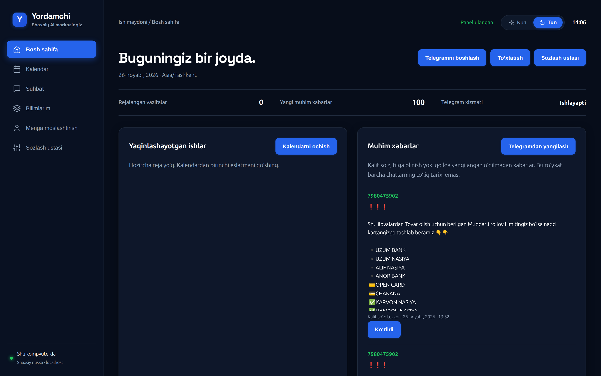
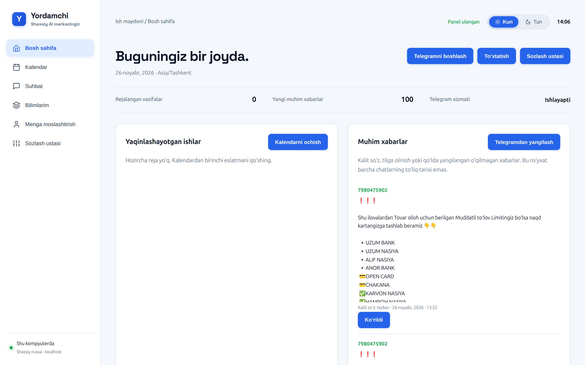
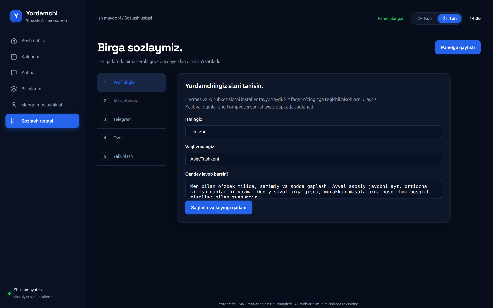
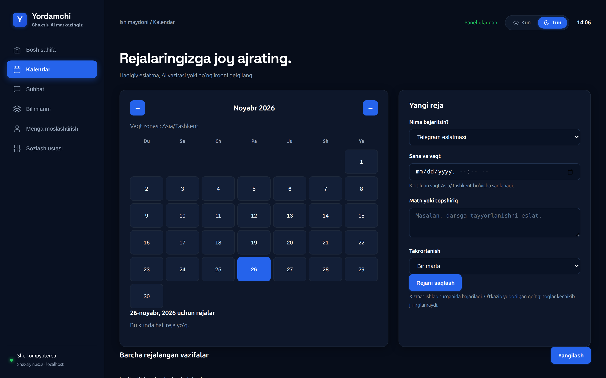
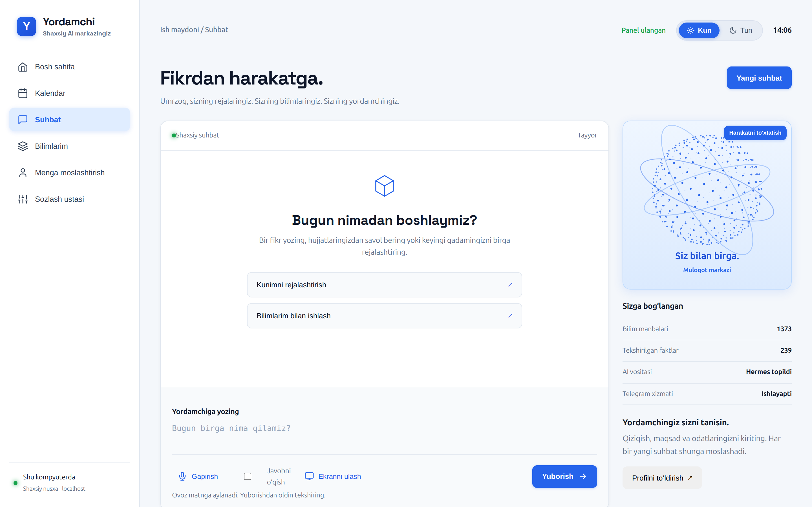
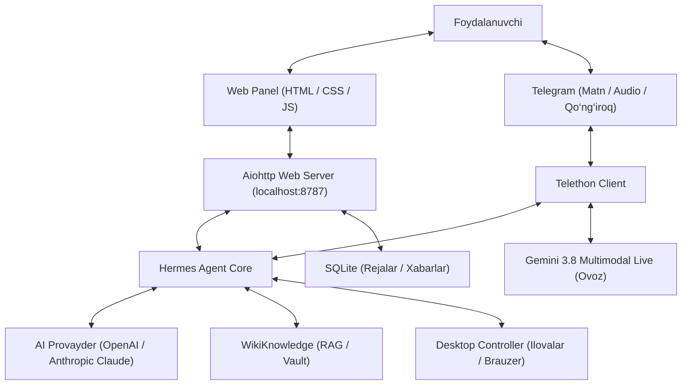

<div align="center">

# ⚡ Yordamchi — Shaxsiy AI Markazingiz

### Bitta installer. O‘zbekcha sozlash ustasi. Real-time Gemini ovozli qo‘ng‘iroqlar & Desktop boshqaruvi.

**Dual Theme (Kun ☀️ / Tun 🌙) · Gemini 3.8 Multimodal Live · OpenAI & Claude · Telegram · Desktop Nazorati · Shaxsiy Bilimlar (RAG)**

[O‘rnatish](#birinchi-marta-ornatish) · [Imkoniyatlar](#-asosiy-imkoniyatlar) · [Sozlash qadamlari](#sozlash-ustasining-5-qadami) · [Web panel](#web-panelda-nimalar-bor) · [Telegram buyruqlari](#-telegram-buyruqlari) · [Muallif](#-muallif--dasturchi)

<br/>

<p align="center">
  
  
</p>
<p align="center"><i>Yordamchi Web Boshqaruv Paneli — Tun (Dark Mode) va Kun (Light Mode) rejimlari</i></p>

</div>

Yordamchi har kim o‘z kompyuteriga, o‘z hisoblari bilan o‘rnatadigan mustaqil sun'iy intellekt assistenti. **Hermes’ni alohida o‘rnatish yoki Telegramni terminaldan ulash talab qilinmaydi.** Installer Python, kutubxonalar va Hermes’ni tayyorlaydi, keyin brauzerda o‘zbekcha zamonaviy sozlash ustasini ochadi.


## ✨ Asosiy imkoniyatlar

1. 🎨 **Pixel-Perfect Dual Theme (Kun ☀️ / Tun 🌙):**
   - **Tun (Dark Mode):** Chuqur midnight navy fon (`#070d1a`), quyuq yon panel (`#091122`), faol qirollik ko‘k elementlar (`#2563eb`).
   - **Kun (Light Mode):** Yumshoq havo-rang fon (`#f4f7fb`), oppoq yon panel (`#ffffff`), ko‘k aksentli chiroyli kartochkalar.
   - Tezkor almashtirgich, `localStorage` orqali saqlanish va tizim (`prefers-color-scheme`) rejimiga avtomatik moslashuv.
   - Matematik tekislangan vertikal navigatsiya paneli va zamonaviy **"Y" squircle** logotipi.

2. 🎙️ **Real-time Multimodal Live Ovozli Muloqot:**
   - **Google Gemini 3.8 Live** neyrotarmog‘i orqali to‘g‘ridan-to‘g‘ri real-vaqt rejimida (Speech-to-Speech) suhbat.
   - Robotik TTS emas, balki jonli insoniy emotsiyalar, pauzalar, intonatsiya va real-vaqtda to‘xtatib gapirish (barge-in) imkoniyati.
   - Ovozlar: **`Aoede`** (mayin qiz bola), **`Kore`** (quvnoq qiz bola), **`Rasalgethi`** (bosiq yigit kishi).

3. 🖥️ **Kompyuterni ovoz orqali boshqarish (Desktop Controller):**
   - Telegram yoki Web orqali topshiriq berganda kompyuterdagi ilovalarni ochish va boshqarish:
     - Masalan: *"YouTube'ni och"*, *"Google'dan qidir"*, *"Telegram'ni och"*, *"Brauzerni ishga tushir"*.
   - Windows, macOS va Linux (`xdg-open`) uchun moslashgan avtomatik desk controller.

4. 🧠 **Mahalliy Xotira & Shaxsiy Bilimlar Ombori (RAG):**
   - Hujjatlar (PDF, DOCX, TXT, MD, Python, Excel, CSV) ni Drag & Drop orqali yuklash (100 MB gacha).
   - Mahalliy qidiruv tizimi ma'lumotlaringizni xavfsiz saqlaydi va savollaringizga shaxsiy hujjatlaringiz asosida aniq iqtiboslar bilan javob beradi.

5. 📅 **Aqlli Kalendar & Rejalashtiruvchi (Scheduler):**
   - Telegram eslatmalari, AI vazifalari va **jonli qo‘ng‘iroqlar**ni vaqtga qarab rejalashtirish.
   - Bir marta, har kuni yoki har haftalik avtomatik takrorlanish.

6. 🌐 **Interaktiv 3D Yadro ("Siz bilan birga"):**
   - Canvas asosida yaratilgan uch o‘lchamli aylanuvchi zarrachalar yadrosi — agentning o‘ylash, tinglash va gapirish holatlarini real-vaqtda aks ettiradi.


## 🎙️ Ovozli jonli muloqot va Telegram boshqaruvi

### 📱 Telegram buyruqlari

Telegram orqali agent bilan muloqot qilish uchun qulay tezkor buyruqlar:
* `/call` — Telegram orqali real-vaqtda jonli ovozli qo‘ng‘iroq boshlash.
* `/hangup` — Faol qo‘ng‘iroqni yakunlash.
* `/voice aoede` — Ovozni `Aoede` (mayin qiz bola)ga o‘zgartirish.
* `/voice kore` — Ovozni `Kore` (quvnoq qiz bola)ga o‘zgartirish.
* `/voice rasalgethi` — Ovozni `Rasalgethi` (yigit kishi)ga qaytarish.
* `/status` — Agent, xotira, modellar va fon xizmati holatini tekshirish.
* `/pause` / `/resume` — Avtomatik rejalashtirilgan vazifalarni to‘xtatish yoki davom ettirish.


## Birinchi marta o‘rnatish

1. [**ZIPni yuklab oling**](https://github.com/Umrzoq-backend-ai/yordamchi/archive/refs/heads/main.zip).
2. ZIPni **to‘liq oching** va `yordamchi-main` papkasiga kiring.
3. **Windows:** `install.cmd`ni ikki marta bosing. **macOS/Linux:** shu papkada terminaldan `bash scripts/install.sh`ni bajaring.
4. O‘rnatish tugashini kuting. **Brauzerda sozlash ustasi avtomatik ochiladi.** Oynani yopmang; birinchi o‘rnatish yuklash tezligiga qarab bir necha daqiqa vaqt olishi mumkin.
5. Ustadagi qadamlarni bajarib **Keyingi qadam**ni bosing.

Git orqali o'rnatish:

```bash
git clone https://github.com/Umrzoq-backend-ai/yordamchi.git
cd yordamchi
```


## Sozlash ustasining 5 qadami

| Qadam | Nima qilasiz? | Usta qanday yordam beradi? |
|---|---|---|
| **1. Profilingiz** | Ism, vaqt zonasi va javob uslubini yozasiz | O‘zbekcha yorliqlar va aniq misollar |
| **2. AI hisobingiz** | OpenAI yoki Claude tanlaysiz; rasmiy loginni tasdiqlaysiz | Rasmiy havola va vaqtinchalik kod shu oynada ko‘rinadi |
| **3. Telegram** | API ID/hash, yordamchi telefon raqami, kelgan kod | my.telegram.org’da ilova yaratish bo‘yicha qadam-baqadam yo‘riqnoma |
| **4. Ovoz** | Brauzer ovozi yoki Gemini jonli ovozini tanlaysiz | Mikrofon/ovoz sinovi, Gemini kalitini qayerdan olish va tekshirish |
| **5. Yakunlash** | AI javobini sinaysiz, muhim xabar qoidalarini belgilaysiz | Model haqiqiy javob bermaguncha yakunlash ochilmaydi |

<div align="center">
  
</div>


## Web panelda nimalar bor?

| Bo‘lim | Vazifasi |
|---|---|
| **Bosh sahifa** | Yaqinlashayotgan ishlar, yangi muhim xabarlar va xizmat holati; Telegramni boshlash/to‘xtatish |
| **Kalendar** | Oy ko‘rinishi, kunni tanlash, Telegram eslatmasi, AI vazifasi yoki qo‘ng‘iroq rejalash |
| **Suhbat** | Profil va bilimlarga tayangan AI muloqoti; mikrofon, ekran ulash (vision) va 3D yadro |
| **Bilimlarim** | Qayd, hujjat (PDF, Word, Excel, CSV), qidiruv va manbalarni boshqarish |
| **Menga moslashtirish** | Til, uslub, shaxsiy maqsadlar, tanishtirish va AI model nomi |
| **Sozlash ustasi** | Hisob, Telegram va ovozni bir oqimda ulash yoki qayta sozlash |

<div align="center">
  
  
</div>

<br/>

## Keyingi safar qanday ochaman?

* **Windows:** `start-web.cmd` faylini bosing.
* **macOS/Linux:** Loyiha papkasidan terminalda:
  ```bash
  .venv/bin/hpa web
  ```
  Panel `http://127.0.0.1:8787` manzilida avtomatik ochiladi.


## Arxitektura va texnologiyalar



| Texnologiya | Vazifasi |
|---|---|
| **Python 3.11+** | Backend API, agent, rejalashtiruvchi va CLI tizimi |
| **Google GenAI / Gemini** | Real-time Speech-to-Speech jonli ovozli qo‘ng‘iroqlar |
| **Telethon + py-tgcalls** | Telegram mijoz sessiyasi va qo‘ng‘iroq oqimi |
| **HTML / CSS / JavaScript** | Yengil, toza, zamonaviy interfeys; og‘ir frameworklarsiz tezkor yuklanish |
| **Canvas 3D Mathematics** | Interaktiv aylanuvchi zarrachali yadro orbi |
| **SQLite + WikiKnowledge** | Mahfiy shaxsiy ma'lumotlar va RAG bilimlar ombori |
| **uv** | Ultra-tezkor paketlar boshqaruvchisi |


## Ma’lumotlar xavfsizligi

Barcha shaxsiy ma'lumotlar, fayllar, kalitlar va sessiyalar faqat **o‘zingizning kompyuteringizda** saqlanadi:

* **Windows:** `%LOCALAPPDATA%\HermesPersonalAgent`
* **Linux:** `~/.local/share/HermesPersonalAgent`
* **macOS:** `~/Library/Application Support/HermesPersonalAgent`

Hech qanday shaxsiy ma'lumot, Telegram sessiyasi yoki xabarlar tashqi serverlarga yuborilmaydi.

---

## 👤 Muallif & Dasturchi

* **Dasturchi:** Umrzoq Yulchiyev
* **Telegram:** [@umrzoq_21](https://t.me/umrzoq_21)
* **GitHub:** [@Umrzoq-backend-ai](https://github.com/Umrzoq-backend-ai)
* **Email:** school21dev@gmail.com

---

MIT Litsenziyasi asosida tarqatiladi.
